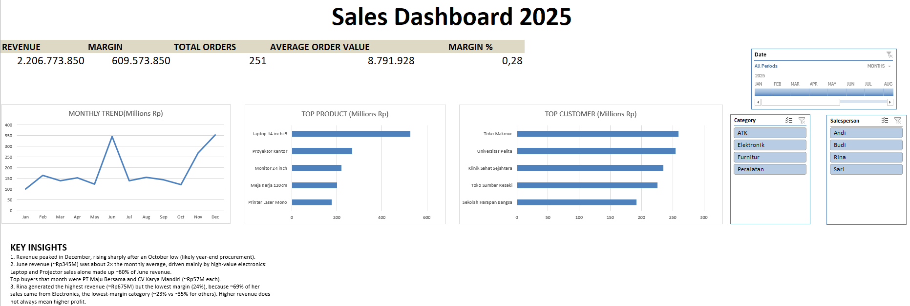

# Sales Performance Dashboard 2025 (Excel)

An interactive Excel dashboard analyzing one year of sales data for an office-supplies distributor. Built to answer one question: **where does revenue come from, and is it profitable?**

> **Note:** The dataset is synthetic. It is modeled on an ERP (Odoo) Sales Order Lines export: 508 order lines, 251 completed orders, 20 products, 15 customers, 4 salespeople, January–December 2025.

---

## Business Questions

1. How did revenue and margin develop over the year?
2. Which products and customers contribute the most revenue?
3. Are the top-selling salespeople also the most profitable?

## Dataset

| Table | Description |
|---|---|
| `Penjualan` (Sales) | Order lines: date, SO number, customer code, product code, qty, unit price, discount, salesperson, status |
| `Master_Produk` (Products) | Product name, category, unit cost (HPP), selling price |
| `Master_Customer` (Customers) | Customer name, city, type |

**Business rules applied**
- Revenue = Qty × Unit Price × (1 − Discount)
- Margin = Revenue − (Qty × Unit Cost)
- Only orders with status **Done** are counted. Cancelled lines (27 rows) are excluded.

## Process

1. **Data preparation**: converted the raw data to Excel Tables and added calculated columns (Subtotal, Margin).
2. **Lookups**: pulled product name, category, cost and customer name from the master tables using `INDEX-MATCH` / `VLOOKUP`.
3. **Counting real orders**: one Sales Order can contain several lines, so a row count overstates orders. Since Distinct Count (Data Model) was not available, I used a helper column `=1/COUNTIFS([No_SO],[@No_SO])`. Summing it gives the exact number of unique orders.
4. **Analysis**: built PivotTables for KPIs, monthly trend, top 5 products and top 5 customers.
5. **Dashboard**: PivotCharts with Slicers (Category, Salesperson) and a Timeline (Date), connected to every pivot so all KPIs and charts filter together.
6. **Root-cause analysis**: used the slicers to drill into anomalies (the June spike, salesperson margin gaps).

## Key Metrics (FY 2025)

| Revenue | Margin | Margin % | Total Orders | Avg. Order Value |
|---|---|---|---|---|
| Rp 2,206,773,850 | Rp 609,573,850 | 27.6% | 251 | Rp 8,791,928 |

## Key Insights

1. **Year-end peak.** Revenue peaked in December, rising sharply after an October low. This is likely driven by year-end procurement.
2. **June spike came from product mix.** June revenue (~Rp345M) was about 2× the monthly average. Laptop and Projector sales alone made up ~60% of it. The top buyers that month were PT Maju Bersama and CV Karya Mandiri (~Rp57M each).
3. **Highest revenue ≠ highest profit.** Rina generated the highest revenue (~Rp675M) but the lowest margin (24%). About 69% of her sales came from Electronics, the lowest-margin category (~23% vs ~35% for other categories). Discounts were not the cause: her discount rate was among the lowest.

## Recommendations

- Track **margin**, not just revenue, in salesperson performance reviews and incentive schemes.
- Encourage bundling of higher-margin categories (Furniture, Office Supplies) with Electronics deals.
- Plan stock and cash flow ahead of the Q4 demand peak.

## Skills Demonstrated

Excel Tables · INDEX-MATCH / VLOOKUP · SUMIFS / COUNTIFS · PivotTables & PivotCharts · Slicers & Timeline · KPI design · Root-cause analysis · Business communication

## Files

- `Sales_Dashboard_2025.xlsx`: workbook with raw data, pivots and dashboard
- `dashboard.png`: dashboard screenshot
